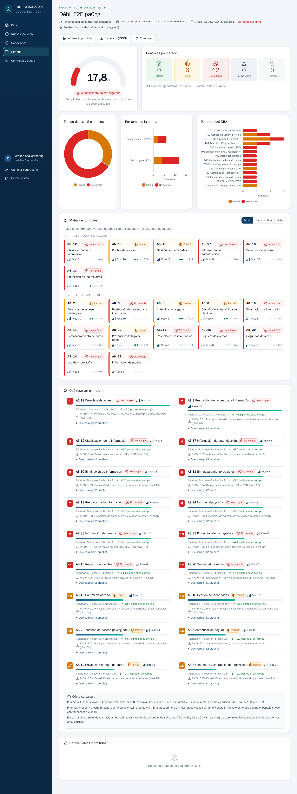

# Sistema de auditoría ISO/IEC 27001:2022 para Oracle

Sistema web que se conecta a una base de datos Oracle, ejecuta pruebas de solo lectura sobre **18 controles** del Anexo A de ISO/IEC 27001:2022 orientados a la confidencialidad y muestra, para cada control, **si cumple o no y por qué**, con el comando, la consulta y la **salida real** de la base. Pondera los controles por riesgo, calcula un puntaje, recomienda **qué resolver primero** y deja **historial y registro de auditoría** de quién hizo cada prueba.

Proyecto del curso EIF402 Administración de Bases de Datos (UNA Costa Rica), "Controles ISO/IEC 27001:2022 para la confidencialidad en la administración de bases de datos Oracle".



## Arranque rápido

Requisitos: Docker Desktop (Mac con Apple Silicon o equipo x86-64). La imagen descarga Oracle Instant Client al construirse.

```bash
cd ~/Desktop/sistema-auditoria-iso27001
```
```bash
cp .env.example .env
```
Edite `.env`: ponga una contraseña de al menos 12 caracteres en `ADMIN_PASSWORD` y un valor aleatorio en `SESSION_SECRET` (`openssl rand -hex 32`). Luego:
```bash
docker compose up --build
```
Abra **http://localhost:3000** e ingrese con `ADMIN_USER` / `ADMIN_PASSWORD`. Esa contraseña es definitiva; si quiere otra, puede cambiarla cuando quiera en *Cambiar contraseña*. Todos los campos de contraseña tienen un botón con un ojo para ver lo que se escribe.

Para detenerlo: `docker compose down` (los datos quedan en el volumen `datos_sistema`). Para borrar también los datos del sistema: `docker compose down -v`.

## Preparar la base auditada: cuenta ISO_AUDIT

El sistema no necesita SYS ni el rol DBA. Cree una vez, en cada base que vaya a auditar, la cuenta de mínimo privilegio con [`sql/crear_usuario_auditoria.sql`](sql/crear_usuario_auditoria.sql), conectado como SYS o SYSTEM a la PDB:

```bash
sqlplus sys/<clave>@//localhost:1522/FREEPDB1 as sysdba @sql/crear_usuario_auditoria.sql "<clave de ISO_AUDIT>"
```

La cuenta recibe `CREATE SESSION`, el rol `AUDIT_VIEWER` (lectura de `UNIFIED_AUDIT_TRAIL`) y `READ` sobre las 34 vistas exactas que leen las pruebas, sin `SELECT_CATALOG_ROLE`. Tiene su propio perfil (`PRF_ISO_AUDIT`: 5 intentos, 90 días, `ORA12C_STRONG_VERIFY_FUNCTION`), así que la clave necesita 2 mayúsculas, 2 minúsculas, 2 dígitos y 2 caracteres especiales. El script es idempotente.

Si no tiene SQL*Plus a mano, la carpeta `herramientas/` trae una imagen con SQL*Plus de Instant Client:

```bash
docker build -t iso-sqlplus -f herramientas/Dockerfile.sqlplus herramientas
```
```bash
docker run --rm -i -v "$PWD/sql":/sql iso-sqlplus -s -L "sys/<clave>@//host.docker.internal:1522/FREEPDB1 as sysdba" @/sql/crear_usuario_auditoria.sql "<clave de ISO_AUDIT>"
```

## Uso en pasos cortos

**Crear una cuenta propia**: en la pantalla de inicio de sesión, *Crear cuenta* → nombre, usuario y contraseña (12+ caracteres) → *Crear cuenta*. La cuenta queda con rol **Analista** y entra directo al panel. Para desactivar esta opción, ponga `PERMITIR_REGISTRO=false` en `.env`.

**Crear usuarios** (administrador): menú *Usuarios* → formulario *Nuevo usuario* → usuario, nombre, rol (Administrador, Analista o Auditor) y contraseña (12+ caracteres) → *Crear usuario*. Esa contraseña es la definitiva: no hay que cambiarla al ingresar. Desde la misma tabla se cambia el rol, se desactiva o se restablece la contraseña.

**Registrar una conexión** (administrador o analista): menú *Conexiones* → *Registrar conexión* → alias, host, puerto, servicio y usuario (por ejemplo `host.docker.internal`, `1522`, `FREEPDB1`, `ISO_AUDIT`) → *Registrar*. Con *Probar conexión* se ve la versión, la PDB y si el canal va cifrado. **La contraseña de la base nunca se guarda.**

**Ejecutar una prueba** (administrador o analista): *Nueva ejecución* → elija la conexión → escriba la contraseña de `ISO_AUDIT` → opcionalmente active *Pruebas funcionales*, elija el perfil **Laboratorio SEGCONF** y escriba las contraseñas de los usuarios de prueba → *Ejecutar auditoría*. Una barra muestra el avance y al terminar aparece el resultado.

**Ver el resultado**: medidor del puntaje (semáforo), estado de los 18 controles, gráficos por tema y por tarea del DBA, matriz de controles, lista de prioridades con la fórmula y los motivos de lo no evaluable u omitido. Al pulsar un control se abren sus pruebas con el panel de terminal (comando, consulta, salida real, por qué cumple o no y cómo corregirlo).

**Historial y comparación**: *Historial* filtra por usuario, conexión y fechas. Marque dos ejecuciones de la misma conexión y pulse *Comparar seleccionadas*.

**Informe**: en los resultados, *Informe imprimible* → *Imprimir / Guardar PDF*. *Evidencia (JSON)* descarga todo el detalle.

## Roles

| Acción | Administrador | Analista | Auditor |
|---|---|---|---|
| Crear, desactivar y cambiar el rol de usuarios, restablecer contraseñas | Sí | No | No |
| Crear su propia cuenta desde el inicio de sesión | — | Sí (la cuenta nace como analista) | — |
| Registrar conexiones y ejecutar pruebas | Sí | Sí | No |
| Ver historial y resultados | Todos | Solo los propios | Todos (solo lectura) |
| Ver el registro de auditoría | Sí | No | Sí |
| Descargar o imprimir informes | Sí | Los propios | Todos |

## Bases del laboratorio

| Objetivo | Contenedor | Puerto en el Mac | Desde el contenedor del sistema |
|---|---|---|---|
| Endurecida | `eif402-iso27001` | 1522 | `host.docker.internal:1522/FREEPDB1` |
| Débil | `eif402-debil` | 1523 | `host.docker.internal:1523/FREEPDB1` |

`host.docker.internal` es el nombre con el que un contenedor alcanza el Mac en Docker Desktop. `docker-compose.yml` lo declara también con `extra_hosts` para que funcione en Linux.

## Pruebas automáticas

```bash
docker build --target pruebas -t iso27001-pruebas . && docker run --rm iso27001-pruebas
```
43 pruebas (Node `node:test` + supertest, con un conector simulado): puntaje, orden de prioridades, permisos por rol, hash encadenado, validación de identificadores, rechazo de SQL que no sea de lectura, bloqueo por intentos, CSRF y ausencia de contraseñas en SQLite, auditoría y respuestas HTTP.

Pruebas de punta a punta con Playwright (Chromium) contra las dos bases reales; generan las capturas de `docs/capturas/`. Corren contra una **instancia aparte y desechable** del sistema (servicio `app-e2e`, datos en memoria), así que no tocan sus usuarios ni su historial. Necesitan en `.env` las variables `E2E_*` (ver `.env.example`); `E2E_ADMIN_CLAVE` es la contraseña del administrador de esa instancia de prueba:

```bash
docker compose --profile e2e run --rm e2e
```

## Documentación

- [docs/arquitectura.md](docs/arquitectura.md): diagrama, decisiones y seguridad.
- [docs/catalogo-controles.md](docs/catalogo-controles.md): controles, pruebas, consultas, pesos y fórmulas (generado desde el código).
- [docs/resultados.md](docs/resultados.md): resultado contra la base débil y la endurecida, y explicación de cada control que no cumple.
- [docs/PROBLEMAS.md](docs/PROBLEMAS.md): problemas encontrados y cómo se resolvieron.
- [docs/capturas/](docs/capturas/): capturas de las vistas principales.

## Eliminar la base débil de prueba

Esto borra solo `eif402-debil`, su volumen y la copia temporal; no toca el laboratorio endurecido `eif402-iso27001`:

```bash
docker rm -f eif402-debil
```
```bash
docker volume rm eif402_debil_data
```
```bash
rm -rf /tmp/lab-debil
```
