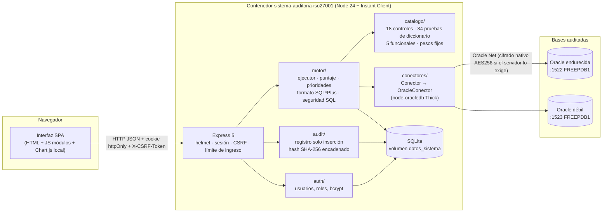
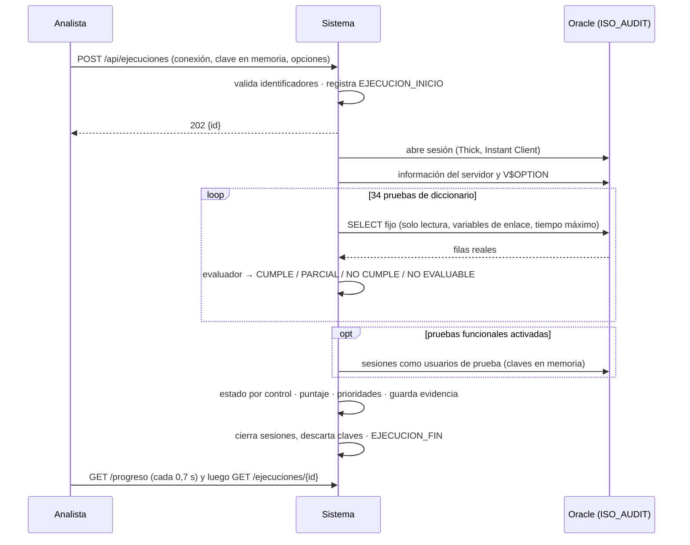

# Arquitectura y decisiones

## Vista general



Flujo de una ejecución:



## Estructura del código

| Carpeta | Contenido |
|---|---|
| `src/config` | Variables de entorno (sin secretos en el código) |
| `src/db` | Esquema SQLite, migración y almacén de sesiones |
| `src/auth` | Política de contraseñas (bcryptjs, costo 12), servicio de usuarios, matriz de permisos, middlewares de sesión, rol y CSRF |
| `src/audit` | Registro de auditoría de solo inserción con hash encadenado y verificación de integridad |
| `src/conectores` | Interfaz `Conector`, `OracleConector` y registro de motores |
| `src/catalogo` | Controles, riesgos, tareas, pesos, pruebas de diccionario, pruebas funcionales y perfiles |
| `src/motor` | Ejecutor, cálculo de puntaje y prioridades, formato SQL*Plus, reglas de seguridad SQL |
| `src/rutas` | API REST: auth, usuarios, conexiones, ejecuciones, auditoría |
| `public` | Interfaz (vistas por módulo, CSS propio, íconos SVG en línea) |
| `tests` | Pruebas unitarias y de API (`node:test`), y E2E con Playwright |
| `sql` | `crear_usuario_auditoria.sql` |
| `herramientas` | Imagen opcional con SQL*Plus y generador de `docs/catalogo-controles.md` |

## Decisiones

| Tema | Decisión | Motivo |
|---|---|---|
| Imagen base | `node:24-bookworm-slim` (Debian 12, arm64 o amd64 según la plataforma) | Debian 12 todavía trae `libaio1` con ese nombre (Debian 13 lo renombró a `libaio1t64`, que Instant Client no busca). Node 24 es LTS y `better-sqlite3` 13 exige Node ≥ 22. |
| Instant Client | **Basic Light 23.26.1** para Linux arm64, descargado de `download.oracle.com/otn_software/linux/instantclient/instantclient-basiclite-linux-arm64.zip` al construir. La variable `IC_URL` permite fijar otra versión. | Es la variante más pequeña que soporta modo Thick; incluye mensajes en inglés y los juegos de caracteres comunes (AL32UTF8). Se registra con `ldconfig`. |
| node-oracledb | 26.0.0 en **modo Thick** (`initOracleClient`) | El servidor endurecido exige `SQLNET.ENCRYPTION_SERVER=REQUIRED` y el modo Thin no soporta el cifrado nativo de Oracle. Verificado en el hito 1: el banner muestra AES256 y SHA512. |
| Cliente Oracle | Sin `sqlnet.ora` de cliente (valores por defecto: cifrado `ACCEPTED`) | Así la prueba A8.20 mide lo que exige el servidor: si la sesión sale cifrada es porque el servidor lo pidió. |
| Almacenamiento propio | SQLite (`better-sqlite3`) en el volumen `datos_sistema`, modo WAL | Simple, sin otro servidor; nunca se usa la base auditada. |
| Contraseñas | `bcryptjs` costo 12; mínimo 12 caracteres y sin el nombre de usuario | `bcryptjs` es JavaScript puro (sin compilación nativa en arm64). |
| Sesiones | `express-session` con almacén propio en SQLite; cookie `sid` `httpOnly`, `SameSite=Strict`, `rolling` con expiración por inactividad (20 min por defecto); se regenera al ingresar | Evita fijación de sesión; sobrevive a reinicios si `SESSION_SECRET` es fijo. |
| CSRF | Token sincronizado en la sesión, enviado en la cabecera `X-CSRF-Token` en toda petición que no sea GET (incluido el ingreso) | El paquete `csurf` está abandonado; el mecanismo propio es corto y se prueba. |
| Contraseña inicial | Es definitiva: ni el administrador inicial, ni las cuentas que crea el administrador, ni las restablecidas tienen que cambiarla. Cambiarla es opcional. | Pedido del usuario del sistema; reemplaza el cambio obligatorio del enunciado original. La columna `debe_cambiar` se conserva y al arrancar se pone en 0. |
| Crear cuenta | Registro público desde el inicio de sesión (`POST /api/auth/registro`), siempre con rol **analista**, con la misma política de contraseñas, CSRF, límite por IP y registro `USUARIO_REGISTRO`. Se desactiva con `PERMITIR_REGISTRO=false`. | Un analista solo ve sus propias ejecuciones; nadie puede darse el rol de administrador o auditor. |
| Mostrar contraseña | Botón con un ojo en todo campo de contraseña (`activarOjos` en `public/js/ui.js`, también en diálogos); se vuelve a ocultar al enviar | El campo conserva su nombre accesible (`aria-labelledby` a la etiqueta). |
| Bloqueo | 5 intentos fallidos → bloqueo de 15 min (`BLOQUEO_MIN`); además `express-rate-limit` por IP en el ingreso | Requisito del enunciado. Mensaje genérico para no revelar si el usuario existe; tiempo constante con un hash ficticio. |
| Cabeceras | `helmet` con CSP `default-src 'self'` sin estilos ni scripts en línea; HSTS y COOP solo si `COOKIE_SECURE=true` | Los navegadores ignoran HSTS y COOP en HTTP y Chromium lo informa como error en consola. |
| Interfaz | SPA sin framework, módulos ES, plantillas con escape automático (`html```), Chart.js servido desde `node_modules` | Sin CDN y sin paso de compilación; el escape evita XSS con datos que vienen de la base auditada. |
| Ejecución | En segundo plano en el mismo proceso; la interfaz consulta el avance cada 0,7 s | Más simple que WebSockets o SSE. Si el servidor se reinicia, las ejecuciones en curso quedan en ERROR. |
| Evidencia | Por prueba se guardan comando, variables de enlace, consulta, salida formateada como SQL*Plus y hasta 50 filas | Suficiente para respaldar el resultado sin inflar la base. |
| Población auditada | Esquemas de aplicación = `DBA_USERS.ORACLE_MAINTAINED = 'N'`. Las pruebas de cuentas excluyen la cuenta de sesión (`ISO_AUDIT`) | `ISO_AUDIT` la crea el script de esta herramienta con perfil propio; incluirla hacía que la base débil saliera "Parcial" en vez de "No cumple". |
| Heurística A5.12 | Columnas sensibles por nombre (patrón en `src/catalogo/pruebas.js`), marcadas como heurísticas | No hay tabla de clasificación formal en una base genérica. |
| Pruebas funcionales | Validación de identificadores `^[A-Z][A-Z0-9_$#]{0,29}$` + comillas dobles para tabla, columnas y usuarios | La regla del enunciado para A8.33 se aplica a toda prueba funcional, porque todas reciben nombres del analista. |
| Redacción (PB-05b) | La cuenta de referencia solo responde `IGUAL`/`DISTINTO` por columna | Ningún valor real de producción llega al sistema. |
| Clon (PB-10) | Ambas cuentas calculan `STANDARD_HASH(:sal \|\| TO_CHAR(col), 'SHA256')` con una sal aleatoria de 16 bytes que solo existe en memoria; el sistema empareja por clave. La sal se muestra como `********` | Comparar con una cuenta privilegiada fallaba: SYSTEM está sujeta a VPD y a redacción (ver PROBLEMAS.md). Con sal, los hashes guardados no permiten adivinar valores de baja entropía. |
| Respaldo (A8.13) | Se evalúa `V$BACKUP_PIECE` desde la PDB | Se comprobó con `ISO_AUDIT` en FREEPDB1 que la vista muestra las piezas de la CDB registradas en el archivo de control; no hizo falta una segunda conexión a CDB$ROOT. |
| Parches (A8.8) | Si `DBA_REGISTRY_SQLPATCH` está vacía, queda PARCIAL con la versión y la explicación | En Oracle Free la vista está vacía; no se inventa el nivel de parche. |
| Contraseñas de la base | Solo en el cuerpo de la petición y en variables locales del ejecutor; se ponen en `null` al terminar | No se registran ni se escriben en SQLite. Limitación: JavaScript no permite borrar de memoria el contenido de un string. |

## Seguridad del propio sistema

- **Registro de auditoría**: tabla `audit_log` de solo inserción. Cada fila guarda `hash_anterior` y `hash = SHA-256(hash_anterior | JSON(campos))`. No hay rutas ni funciones para modificar o borrar, y dos disparadores de SQLite rechazan `UPDATE` y `DELETE`. La vista del auditor recalcula la cadena completa y avisa si un registro fue alterado, falta uno intermedio o se rompió el enlace. Limitación: quien tenga acceso al archivo puede borrar los últimos registros sin dejar hueco; para eso habría que anclar el último hash fuera del sistema.
- **Acciones registradas**: USUARIO_REGISTRO, LOGIN_OK, LOGIN_FALLIDO, LOGIN_LIMITE, BLOQUEO_CUENTA, LOGOUT, CAMBIO_CLAVE, USUARIO_ALTA, USUARIO_BAJA, USUARIO_REACTIVACION, USUARIO_CAMBIO_ROL, USUARIO_RESTABLECER_CLAVE, CONEXION_ALTA, CONEXION_BAJA, CONEXION_REACTIVACION, CONEXION_PRUEBA, EJECUCION_INICIO, EJECUCION_FIN, HISTORIAL_CONSULTA, RESULTADO_CONSULTA, COMPARACION_CONSULTA, INFORME_CONSULTA, INFORME_IMPRESION, INFORME_DESCARGA, AUDITORIA_CONSULTA, AUDITORIA_VERIFICACION, ACCESO_DENEGADO.
- **SQL**: todas las consultas son fijas y están en el código. `asegurarSoloLectura` exige que empiecen con `SELECT` o `WITH`, prohíbe `;`, `FOR UPDATE` y palabras de modificación fuera de literales; además la cuenta `ISO_AUDIT` solo tiene `READ`.
- **Errores**: el manejador de errores nunca devuelve el cuerpo de la petición ni la pila; el servidor no registra cuerpos.
- **HTTP**: el sistema se publica por HTTP en `localhost`. Para usarlo en red, colóquelo detrás de un proxy HTTPS y ponga `COOKIE_SECURE=true` y `TRUST_PROXY=true`.

## Cómo agregar otro motor

1. Implementar una clase que extienda `Conector` (`abrir`, `consultar`, `informacion`, `comandoEquivalente`, `cerrar`).
2. Registrarla en `src/conectores/index.js` (`MOTORES`).
3. Escribir pruebas para ese motor en el catálogo (las actuales usan vistas de Oracle).
